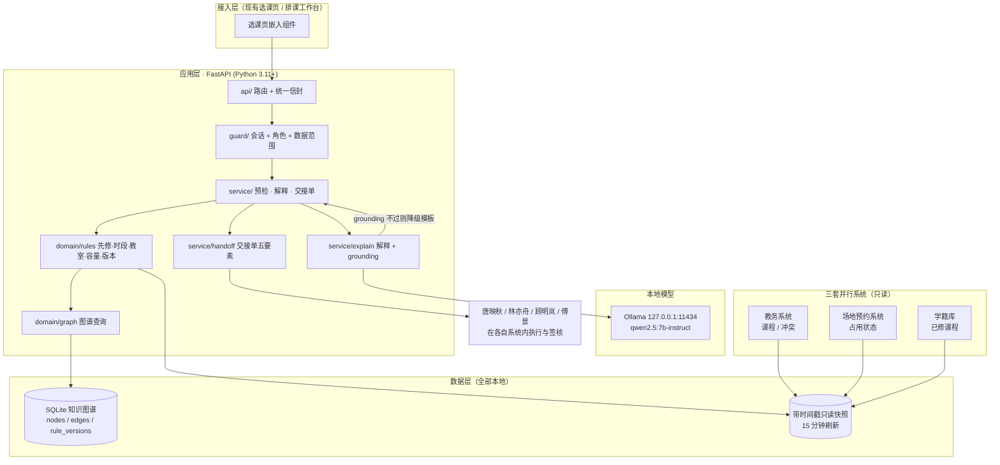

# 排课选课冲突前置校验系统 · 技术方案

> 项目：知行职业学院 · 排课选课与教务协作（原创合成训练案例）
> 阶段：FDE 九阶段 · 04 方案设计（phase2）
> 版本：v1.1（已对齐 01 业务挖掘、02 现场调研成果）
> 上游承接：业务机会 O1—O3、指标基线 M1—M6、六节点现状流程、异常路径 A—D、瓶颈 B1—B3、分歧 D1—D5／X1—X5
> 训练边界声明：六位角色为虚构访谈角色；全程只读核对与人工交接，不代表真实授权、业务执行或客户验收。

**数字口径约定（重要）**：本文所有规模与目标数字均来自角色**口述或估计**，尚未取得选课日志、工时表、交接单等一手记录。凡标 `〔口述〕` 的数字只作量级参考，不写入验收条款；凡标 `〔待采集〕` 的口径必须在试点 W1 取数后才能定稿。这是上游 02 阶段的核心结论，本方案不改动它。

---

## 0. 一页结论

| 项 | 结论 |
|---|---|
| 试点对象 | 瓶颈 B2「校验时点错位」的窄切面：把冲突校验从③选课之后前置到②排课出口；B3 留痕作为附带，因为不留痕就算不出 M1/M3 |
| 试点范围 | **一个专业**（顾明岚验收口径）；先历史回放一个完整学期，再小范围并行试点 |
| 技术路线 | 规则引擎判定 + 知识图谱取事实 + 本地模型（Ollama）只做解释与替代方案 |
| 硬边界 | 只读课程与冲突，不替学生选课、不改成绩、不改培养计划；四类情形一律转人工 |
| 识别率 100% 能否承诺 | **不能无条件承诺**。场地状态不在三套系统内（秦芮），前提不成立（分歧 D5／X4）。方案给出"有条件的 100%"：仅覆盖教务系统已有数据可判定的冲突类型 |
| 首期报价 | ¥76,000（集成 / 培训 / 验证单列），在章程 ¥100,000 预算内，余 ¥24,000 作不可预见费 |
| 首年综合成本 | ¥116,320（首期 76,000 + 运行 21,600 + 人工复核 18,720） |
| ROI 结论 | **由 M4「单笔人工分钟」的待测值决定符号**：< 30 分钟不建议立项；45 分钟约 20 个月回本；60 分钟约 13 个月；90 分钟约 8 个月 |
| 因此 W1 第一件事 | 不是写代码，是测 30 笔冲突的单笔人工分钟（M4）。这一个数字决定项目该不该做 |
| 停止条件 | 四类转人工任一无法闭环、M1 分母口径未双签、单笔人工分钟 < 30 分钟 → 停止扩展 |

---

## 1. 上游承接（本方案如何接住 01／02 阶段的结论）

### 1.1 业务机会：接哪条，怎么接

| 上游 | 内容 | 本方案承接方式 | 不承接的部分及原因 |
|---|---|---|---|
| O1（高） | 排课—场地一致性校验：场地占用/维护状态纳入校验，异常即暂停建议转人工 | 架构设 `adapters/room_client` 拉场地状态；缺失或超期即触发"暂停建议"分支 | 场地预约系统的写入权不在本项目范围，只能读 |
| O2（高） | 选课前置校验 + 替代方案，验收用识别率 100% + 工时 -30% | 核心用例 `POST /precheck`：冲突明细 + ≤2 条替代 + 依据原记录字段 | 识别率 100% 降级为"有条件 100%"，见 1.5 |
| O3（中） | 交接与口径统一：业务编号/版本/状态/未解决事项/接手人做成必填交接单 | 交接单（第 5 章）字段**直接采用这五项**，缺一不得转交 | 不改造学校现有交接制度，只在本系统内强制 |

**明确不做**（与章程一致）：自动改培养计划、自动选课、改成绩。

### 1.2 指标基线：验收只用 M1—M5，M6 不设指标

| 指标 | 上游定义 | 本方案怎么用 |
|---|---|---|
| M1 冲突前置发现率 | 分子=排课完成至选课提交间被拦截并给出可执行替代的冲突笔数；分母=同期纳入校验范围的冲突总笔数（按选课记录去重）；目标 100%〔口述〕；口径顾明岚／取数秦芮／核对唐映秋／复核傅景 | 首要验收指标，但必须先由顾明岚与傅景双签分母口径（Q1） |
| M2 单笔冲突闭环时长 | 分子=Σ(名单确认时间−冲突登记时间)；时间窗=开学周 7 天；目标 ≤1 天〔口述〕；责任人唐映秋（双时间戳） | 系统必须落"冲突登记"与"名单确认"双时间戳，否则 M2 永远算不出来 |
| M3 返工率 | 分子=被退回原步骤≥1 次的业务笔数（退回原因必填）；来源=交接单 | 交接单设"退回原因码"必填，否则 M3 不可计算 |
| M4 人工调整工时 | 分子=排课专员+辅导员在④⑤⑥的工时合计；分母=闭环笔数，输出单笔人工分钟 | **决定 ROI 符号的关键待测值**，见第 7 章 |
| M5 错误建议率（场地误判） | 分子=被人工判定错误的建议数；来源=复核记录（暂停—核对—继续） | 设"建议被驳回"标记，驳回即计入 M5，不隐藏 |
| M6 投诉与反馈 | 依赖叶书事实，未取得 | **本期不设指标**，不预设口径 |

### 1.3 现状流程：只改②③④三个节点

| 节点 | 上游卡点 | 本方案改动 |
|---|---|---|
| ① 教学计划 | 先修关系变更不同步到选课端 | 建规则版本台账，按生效日期锁定（对应异常路径 C） |
| ② 排课 | 场地占用变更不在输入内 | **新增出口条件**：排课前校验场地一致性，异常即标记 |
| ③ 选课 | 列表生成时不做资格实时校验 | **新增预检接口**：提交前即可查到冲突与替代 |
| ④ 冲突校验 | 位于选课之后，只读不能改课 | 保留只读；结果**前置引用**到②③，不再作为唯一发现点 |
| ⑤ 调整 | 退回原因非必填，口头说明不随单 | 转入交接单，退回原因必填 |
| ⑥ 名单确认 | 以接手人确认计完成 | 交接单增"接手人确认"字段与时间戳 |

### 1.4 异常路径：四条都要在系统里有对应分支

| 路径 | 上游描述 | 系统行为 |
|---|---|---|
| A 场地占用未同步 | 课表静态，学生提交被拒才发现 | 场地状态缺失/过期时**不出建议**，只出"数据待刷新，请人工核对"，并记 M5 |
| B 口头说明不入单 | 便签/群消息不随单交接 | 交接单五要素必填，未填不得转交（O3） |
| C 规则两版冲突 | 两次校验结论不同，靠人裁定 | 检测到生效日期重叠即**两版并附**上报傅景，不自行合并、不选宽松条款 |
| D 接口中断 | 页面数据停更 | 用带时间戳只读快照，标"暂未更新"，重连后按业务编号去重补齐 |

### 1.5 分歧处理：不合并，逐条给出方案的立场

| 分歧 | 两边说法 | 本方案的处理 |
|---|---|---|
| D1／X1 规模口径 | 顾明岚：学期 360 个「冲突」；林亦舟、叶书：420 门次课程、日均 120 请求 | 不选边。所有比率只用"笔数"，强制标分母来源；M1 分母待顾明岚与傅景双签（Q1） |
| D2／X2 时间口径 | 3 天→1 天 | 视为**目标**不是现值。系统只负责把两个时间戳落准，现值由 W1 采集 |
| D3 节点位置 | 顾明岚称校验是独立节点；林亦舟称选中后才发现 | 两者不矛盾：**制度上是独立节点，实际执行在选课之后**。方案按实际执行改（前置） |
| D4 留痕口径 | 便签/群 vs 五项齐全 | 制度优于习惯，按五项强制，但保留"补录"入口避免一线抵触 |
| D5／X4 能力口径 | 识别率 100%（顾明岚、傅景）；场地数据不在三套系统内（秦芮） | **本方案最重要的边界**：100% 只在"教务系统已有数据可判定的冲突类型"内成立；场地类冲突仅在接入场地预约后才可能达标 |

### 1.6 瓶颈优先级：与上游一致，不抢跑

上游结论是 **B3（留痕，先做）→ B1（场地状态输入，次之）→ B2（校验时点，最后）**，理由分别是"无前置条件"、"须先拿到场地变更记录"、"须先定 M1 分母口径"。

但业务价值最高的是 B2。本方案的做法是：**以 B2 为价值主张，按 B3→B1→B2 的顺序交付**——先用两周把交接单与留痕做掉（这本身就让 M1/M3 变得可计算），再补场地状态输入，最后才把校验前置上线。这个排序不是妥协：如果 B2 先上线而 M1 分母还没定，识别率就永远无法验收。

---

## 2. 最小试点（solution-wedge）

### 2.1 试点边界

**做：**

- 范围：**一个专业**（章程验收口径），覆盖该专业一个完整学期的课程门次
- 阶段一（W1—W2）：**历史回放**——取最近一个完整学期的选课日志，离线重算冲突，验证判定正确性，不接触真实学生
- 阶段二（W3—W4）：**并行试点**——1—2 个班真实使用预检，与实际教务结果并行比对，不改变任何选课结果
- 输出物：冲突明细（类型／依据原记录字段／待确认字段）+ ≤2 条替代 + 交接单

**不做（写进变更单，防膨胀）：**

- 不做自动选课、不做容量分配与抽签、不做教师排课调整、不做教室自动重排
- 不做跨专业学分互认、不做成绩替代认定
- 不改造学校现有选课页（只提供 JSON 接口 + 一个轻量嵌入组件）
- 不写任何教务库、不改培养计划

### 2.2 三方案比较

| 维度 | A 人工优化（加人 + FAQ） | B 纯确定性规则引擎 | C 规则 + 知识图谱 + 本地模型（本方案） |
|---|---|---|---|
| M1 识别率 | 高但会疲劳，且无留痕 | 高（可审计、可复现） | 高（判定仍由规则做） |
| 对 M2 闭环时长 | 几乎无改善 | 中（学生看不懂错误码，仍要问辅导员） | 高（解释可直接执行，少一次往返） |
| 对 M3 返工率 | 无改善（仍靠便签） | 中 | 高（建议带"待确认字段"，减少退回） |
| 对 M4 单笔工时 | 无改善 | 中 | 高（重复解释显著下降） |
| 落地周期 | 1 周 | 3 周 | 6 周 |
| 首期成本 | ¥15,000（培训/FAQ） | ¥45,000 | ¥76,000 |
| 主要风险 | 人力不可持续、无沉淀 | 输出形态不满足"显示原记录与待确认字段" | 模型幻觉、图谱过期 |
| 可审计性 | 无 | 强 | 强（模型输出须过 grounding 校验） |
| 结论 | 仅兜底 | 作为 C 的降级模式 | **选用** |

**取舍理由：** 选 C，但把 C 的职责压到"只解释、不决策"。判定逻辑全部落在规则引擎——因为 M1 要的是 100%，100% 的东西不能交给概率模型；模型只做两件事：把结构化结论转成人话、把学生口语转成结构化查询。这样即使模型完全不可用，M1 依然成立（见 3.6 降级矩阵）。

### 2.3 为什么必须要有模型（而不是纯规则）

上游对输出形态有一条硬要求：**建议必须显示原记录和待确认字段**（这是异常路径 B 的反面）。纯规则引擎能吐出 `PREREQ_NOT_MET` 这种错误码，但吐不出"你缺的是《程序设计基础》，这条要求在 2024 版培养方案 3.2.1，我引用的是它的第 2 条，待确认的是你 2023 年那次重修是否计入"。

这一层"把依据摊开、把不确定标出来"的表达，正是模型该干的活，也是 M2（闭环时长）能从 3 天往 1 天走的实际原因——学生不用再打一次电话问"我到底差什么"。

### 2.4 试点验收标准

| 指标 | 目标 | 测量方法 | 前置条件 |
|---|---|---|---|
| M1 冲突前置发现率 | 100%（**限定**：教务系统已有字段可判定的冲突类型） | 历史回放一个完整学期，与教务系统已记录冲突逐条比对 | 顾明岚与傅景双签分母口径 |
| M1 漏报 | 0 条 | 同上 | 同上 |
| M5 错误建议率 | < 5% | 并行试点期建议被驳回数 ÷ 建议总数 | 场地状态可得 |
| M2 单笔闭环时长 | ≤1 天〔目标〕 | 系统落"冲突登记"与"名单确认"双时间戳 | 唐映秋确认时间戳来源 |
| M4 单笔人工分钟 | 先测现值，再谈降幅 | W1 抽 30 笔计时，林亦舟填报、唐映秋汇总、傅景抽查 | — |
| 越权用例 | 0 通过 | 32 条权限用例全量回归 | — |
| 模型不可用 | 100% 仍返回规则结论 | 停 Ollama 跑全量用例 | — |

---

## 3. 总体架构

### 3.1 架构图



**架构分层（GitHub 版见上方 Mermaid 图；Word 版以此表为准）：**

| 层 | 组件 | 职责 | 依赖方向 |
|---|---|---|---|
| 接入层 | 选课页嵌入组件 / 排课工作台 | 发起预检、展示结论与依据 | → 接口层（JSON） |
| 接口层 | `api/` 路由 + 统一信封 | 参数校验、鉴权入口、错误归一 | → guard |
| 权限层 | `guard/` 会话 + RBAC + 数据范围 | 判定"谁能看谁的数据"，拒绝即 403 | → service |
| 编排层 | `service/` precheck / explain / handoff | 串起判定、解释、交接单，处理降级 | → domain、adapters |
| 判定层 | `domain/rules` 先修·时段·教室·容量·版本 | **唯一有权给出结论的地方**，纯函数无副作用 | → domain/graph |
| 图谱层 | `domain/graph` + SQLite | 只读遍历、取事实、查规则生效版本 | → `data/kg.db` |
| 适配层 | `adapters/` edu / room / sis / ollama | 三套系统只读拉取、超时熔断、快照时间戳、脱敏 | → 外部只读接口、本机模型 |
| 数据层 | SQLite 图谱 + 只读快照 | 本地单文件，无外部服务 | — |

### 3.2 分层与目录

```text
app/
├── main.py                  # FastAPI 实例装配、中间件、异常兜底
├── config.py                # 读取 config.yaml，禁止硬编码
├── api/
│   ├── deps.py              # 鉴权依赖、请求上下文
│   ├── precheck.py          # 预检接口
│   ├── graph.py             # 图谱只读查询接口
│   └── handoff.py           # 交接单接口（五要素）
├── guard/
│   ├── rbac.py              # 角色-资源-动作矩阵校验
│   └── scope.py             # 数据范围（本人/本班/本专业）校验
├── domain/
│   ├── rules/prereq.py      # 先修闭包判定
│   ├── rules/timetable.py   # 时段与教室冲突判定
│   ├── rules/capacity.py    # 容量判定
│   ├── rules/rule_version.py# 规则版本冲突检测（异常路径 C）
│   └── graph/query.py       # 图谱查询（只读）
├── service/
│   ├── precheck.py          # 预检用例编排
│   ├── explain.py           # 解释生成 + grounding 校验
│   └── handoff.py           # 交接单创建与流转
├── adapters/
│   ├── edu_client.py        # 教务系统只读（课程/冲突）
│   ├── room_client.py       # 场地预约只读（占用状态）
│   ├── sis_client.py        # 学籍库只读（已修课程，仅通过与否）
│   ├── ollama_client.py     # 本地模型（超时/降级）
│   └── kg_store.py          # SQLite 图谱读写
├── prompts/                 # 提示词版本化，见 docs/提示词.md
└── common/
    ├── envelope.py          # {"ok","data","error"} 统一封装
    └── errors.py            # 错误码枚举
config.yaml                  # 唯一配置入口
data/kg.db                   # 知识图谱库文件
tests/                       # pytest 用例 + 32 条权限回归 + 历史回放脚本
```

### 3.3 技术栈（锁定，不替换）

| 层 | 选型 | 说明 |
|---|---|---|
| 语言 | Python 3.11+ | 最低版本要求 |
| Web 框架 | FastAPI + Uvicorn | 唯一 Web 框架 |
| 数据校验 | Pydantic v2（FastAPI 自带） | 不引入 ORM |
| 知识图谱 | SQLite 三元组表 + 邻接索引 | 零外部服务、单文件、可随镜像分发 |
| 本地模型 | Ollama（`/api/chat`） | 只走 127.0.0.1，不出网 |
| 配置 | `config.yaml` + 环境变量覆盖 | 密钥与模型地址只在配置里 |
| 测试 | pytest + httpx | 不引入额外测试中间件 |

**显式不引入：** 不用向量数据库（图谱是结构化遍历，不需要 embedding 检索）、不用消息队列（试点无异步任务）、不用 Redis（SQLite 够）、不用 LangChain（编排只有 4 个函数，自写更可控可测）。

### 3.4 一次预检的运行时序

1. 客户端 `POST /api/v1/precheck`，体：`{student_ref, term, offering_ids[]}`
2. `guard` 校验：会话 → 角色 → `student_ref` 解析为本人才放行
3. `precheck` 读快照时间戳；三套系统任一**超 15 分钟**未刷新即标记 `degraded`
4. `rules.rule_version` 检测该课程是否存在生效日期重叠的两版规则 → 有则**两版并附**，不合并
5. `rules.prereq` / `timetable` / `capacity` 判定
6. 场地类冲突若场地状态缺失 → **不出建议**，只出"数据待刷新，请人工核对"，计入 M5
7. `service.explain` 把脱敏结构化事实交给 Ollama 生成解释；`grounding` 不过即降级模板
8. 需人工处理 → `service.handoff` 建交接单（五要素），状态 `pending`
9. 返回统一信封（含 `data_version`、`degraded`、`basis`）

### 3.5 接口契约

统一响应结构（**所有**接口，含异常路径）：

```json
{ "ok": true, "data": {}, "error": null }
{ "ok": false, "data": null, "error": { "code": "FORBIDDEN_SCOPE", "msg": "只能查询本人选课" } }
```

核心接口：

| 方法 | 路径 | 作用 | 角色 |
|---|---|---|---|
| POST | `/api/v1/precheck` | 冲突预检 + 解释 + 替代 + 依据 | student, counselor, scheduler |
| GET | `/api/v1/graph/prereq-closure` | 查先修闭包（教务复核用） | scheduler, engineer, director, quality |
| POST | `/api/v1/handoff` | 建交接单（不执行变更） | scheduler / counselor |
| PATCH | `/api/v1/handoff/{id}` | 更新状态、填退回原因码、接手人确认 | scheduler, director, quality |
| GET | `/api/v1/metrics/{m1..m5}` | 指标取数（M1—M5） | director, quality |
| GET | `/health` | 存活 + 三套系统与模型连通性 | 无鉴权（仅返回布尔） |

错误码表：

| code | HTTP | 含义 | 客户端行为 |
|---|---|---|---|
| `OK` | 200 | 成功 | — |
| `INVALID_INPUT` | 400 | 参数缺失或格式错 | 提示修正 |
| `UNAUTHENTICATED` | 401 | 无会话 | 跳登录 |
| `FORBIDDEN_SCOPE` | 403 | 越权访问他人数据 | 禁止重试 |
| `NEED_CONFIRM` | 409 | 须人工确认，已建交接单 | 展示单号 |
| `DATA_STALE` | 200 | 数据超 15 分钟未刷新 | 显示"暂未更新" + 时间戳 |
| `RULE_VERSION_CONFLICT` | 409 | 两版规则并存 | 两版并附，提示已上报 |
| `MODEL_UNAVAILABLE` | 200 | 模型不可用，已降级 | 正常展示（`data.degraded=true`） |
| `UPSTREAM_TIMEOUT` | 504 | 三套系统任一超时 | 重试一次后提示 |

### 3.6 降级矩阵（对齐异常路径 D）

| 故障 | 系统行为 | 用户可见 | 上游依据 |
|---|---|---|---|
| Ollama 不可用/超时 | 跳过解释生成，用规则模板话术 | 结论正确，解释较生硬，`degraded=true` | — |
| 模型输出未通过 grounding | 整段丢弃，改用模板 | 同上 | 建议须显示原记录 |
| 接口中断 | 用带时间戳只读快照，标"暂未更新" | 页面显示快照时间 | 秦芮：断连用快照 |
| 数据超 15 分钟 | 标记 `DATA_STALE`，仍给结论 | "数据可能不是最新" | 秦芮：超期标待刷新 |
| 场地状态缺失 | **不出建议**，只出"请人工核对" | 明确说无法判断 | 异常路径 A |
| 两版规则并存 | 两版并附，不合并、不选宽松 | 两个结论都展示 | 唐映秋／傅景 |
| 三套系统全断 | 拒绝预检，返回 `UPSTREAM_TIMEOUT` | 明确文案，不用旧数据猜 | 不用旧数据猜结论 |

---

## 4. 知识图谱设计

### 4.1 本体

**节点（8 类）**

| 节点 | 主键 | 关键属性 | 来源系统 |
|---|---|---|---|
| `Course` 课程 | course_code | 名称、学分、性质 | 教务系统 |
| `Offering` 开课班 | offering_id | 学期、容量、已选数、周次 | 教务系统 |
| `Teacher` 教师 | teacher_id | 工号（姓名仅内部展示，不进模型） | 教务系统 |
| `Room` 教室 | room_id | 容量、类型 | 教务系统 |
| `TimeSlot` 时段 | slot_id | 星期、节次 | 教务系统 |
| `RoomState` 场地状态 | room_id + date | 占用/维护状态、更新时间戳 | **场地预约系统** |
| `RuleClause` 培养方案条款 | clause_id | 条款原文、生效年级、**生效日期区间** | 培养方案 |
| `Major` 专业 | major_code | 名称、年级 | 教务系统 |

> 学生**不建为图谱节点**，只以 `student_ref`（盐化哈希）作查询入参，避免图谱成为 PII 聚合地（傅景：仅授权岗位可看四类数据）。

**边（9 类）**

| 边 | 起点 → 终点 | 判定用途 |
|---|---|---|
| `PREREQUISITE_OF` | Course → Course | 先修闭包 |
| `CO_REQUISITE_OF` | Course → Course | 捆绑校验 |
| `OFFERED_AS` | Course → Offering | 选班 |
| `HELD_IN` | Offering → Room | 教室冲突 |
| `AT_SLOT` | Offering → TimeSlot | 时段冲突 |
| `TAUGHT_BY` | Offering → Teacher | 教师冲突 |
| `ROOM_STATE_OF` | RoomState → Room | 场地一致性校验（O1） |
| `BELONGS_TO` | Course → Major | 范围过滤 |
| `GOVERNED_BY` | Course → RuleClause | 溯源到条款与生效日期 |

### 4.2 存储（SQLite，零外部服务）

```sql
-- 节点表：所有类型共用，props 存 JSON，避免为每类建表
CREATE TABLE nodes (
  id       TEXT PRIMARY KEY,              -- 节点主键，如 course:CS201
  type     TEXT NOT NULL,                 -- Course/Offering/Room/RoomState/RuleClause/...
  props    TEXT NOT NULL DEFAULT '{}',    -- JSON 属性，只放白名单字段
  version  TEXT NOT NULL                  -- 数据版本戳，用于过期判定
);

-- 边表：三元组 + 双向索引，先修闭包靠递归 CTE 遍历
CREATE TABLE edges (
  src     TEXT NOT NULL,                  -- 起点节点 id
  rel     TEXT NOT NULL,                  -- PREREQUISITE_OF / HELD_IN / ROOM_STATE_OF / ...
  dst     TEXT NOT NULL,                  -- 终点节点 id
  props   TEXT NOT NULL DEFAULT '{}',     -- 边属性，如生效年级
  version TEXT NOT NULL,                  -- 数据版本戳
  PRIMARY KEY (src, rel, dst)
);
CREATE INDEX idx_edges_out ON edges(src, rel);   -- 出边索引
CREATE INDEX idx_edges_in  ON edges(dst, rel);   -- 入边索引

-- 规则版本台账：解决"两版并存靠人裁定"（异常路径 C）
CREATE TABLE rule_versions (
  clause_id      TEXT NOT NULL,           -- 条款编号
  effective_from TEXT NOT NULL,           -- 生效日期起
  effective_to   TEXT,                    -- 生效日期止，NULL 表示仍有效
  text           TEXT NOT NULL,           -- 条款原文
  version        TEXT NOT NULL,           -- 数据版本戳
  PRIMARY KEY (clause_id, effective_from)
);

-- 快照元信息：三套系统的拉取时间，用于 stale 判定
CREATE TABLE snapshot_meta (
  source     TEXT NOT NULL,               -- edu / room / sis / kg
  fetched_at TEXT NOT NULL,               -- 最近成功拉取时间（ISO8601）
  version    TEXT NOT NULL,               -- 数据版本戳
  PRIMARY KEY (source)
);
```

**为什么不选 Neo4j / NetworkX：** Neo4j 需额外服务与运维，违反"不引入中间件"；NetworkX 是纯内存图，重启即丢。一个专业 420 门次规模下 SQLite 递归 CTE 在毫秒级，够用。

### 4.3 关键查询

先修闭包（递归 CTE，带环路保护）：

```sql
-- 求某课程的全部（间接）先修，depth 上限防止脏数据形成的环
WITH RECURSIVE pre(course_id, depth) AS (
  SELECT dst, 1 FROM edges WHERE src = :course_id AND rel = 'PREREQUISITE_OF'
  UNION
  SELECT e.dst, p.depth + 1
  FROM edges e JOIN pre p ON e.src = p.course_id
  WHERE e.rel = 'PREREQUISITE_OF' AND p.depth < 6
)
SELECT DISTINCT course_id FROM pre;
```

规则版本冲突检测（存在重叠即两版并附，不合并）：

```sql
-- 找出同一课程在给定日期上同时有效、且条数大于 1 的条款（即两版并存）
SELECT clause_id, COUNT(*) AS n
FROM rule_versions
WHERE clause_id IN (SELECT dst FROM edges WHERE src = :course_code AND rel = 'GOVERNED_BY')
  AND effective_from <= :on_date
  AND (effective_to IS NULL OR effective_to >= :on_date)
GROUP BY clause_id
HAVING COUNT(*) > 1;
```

时段冲突（同一学期内拟选课程两两比对）：

```sql
-- 找出与给定开课班共享同一 TimeSlot 的其他开课班
SELECT b.src AS conflict_offering
FROM edges a
JOIN edges b ON b.dst = a.dst AND b.rel = 'AT_SLOT'
WHERE a.src = :offering_id AND a.rel = 'AT_SLOT' AND b.src <> :offering_id;
```

---

## 5. 权限与人工确认

### 5.1 角色—资源权限矩阵

R=读，W=写（仅本系统的交接单与配置），— 无权限。**对三套业务系统一律只读**（秦芮：接口只读，不能替学生选课或改成绩）。

| 资源 / 角色 | 学生 | 林亦舟 辅导员 | 唐映秋 排课专员 | 秦芮 系统工程师 | 傅景 质量专员 | 叶书 课程负责人 | 顾明岚 教务主任 |
|---|---|---|---|---|---|---|---|
| 本人预检结果 | R | — | — | — | — | — | — |
| 本班预检结果 | — | R | R | — | R（授权岗位，四类数据） | — | R |
| 本专业预检结果 | — | — | R | R | R | R | R |
| 全校预检结果 | — | — | R | R | R | — | R |
| 培养方案 / 条款 / 规则版本 | R | R | R | R | R | R | R |
| 图谱重建 | — | — | — | W | — | — | — |
| 交接单（发起） | — | W（异常登记） | W | — | — | — | — |
| 交接单（退回/接管） | — | W | W | — | — | — | — |
| 交接单（签核确认） | — | — | — | — | R（审计） | — | **W（终审）** |
| 规则两版裁定 | — | — | 上报 | — | **W（裁定，不可代签）** | R | R |
| 数据访问授权 | — | — | — | — | **W（审批）** | — | R |
| 上线/停止否决 | — | — | — | — | **W（关键风险可否决）** | — | R |
| 审计日志 | — | R（本人操作） | R（本人操作） | R | R | — | R |
| 系统配置 / 密钥 | — | — | — | W | — | — | R（只读） |

> 依据：否决权与数据访问审批在傅景，终审在顾明岚，唐映秋可整理校核、发起复核但**不能代替质量专员签核**，叶书参与服务结果验收。

### 5.2 必须转人工的四类情形（采用上游口径，不自创）

| # | 触发 | 系统行为 | 谁能处理 |
|---|---|---|---|
| 1 | 场地占用未同步 / 场地状态缺失 | 不出建议，只出"请人工核对"，计入 M5 | 唐映秋向场地管理方核实 |
| 2 | 资料缺依据（条款缺失或版本不明） | 不出建议，标"依据不足" | 唐映秋 → 叶书确认 |
| 3 | 两版本规则冲突 | 两版并附上报，不合并、不选宽松条款 | 傅景裁定（不可代签） |
| 4 | 关键系统不可用 | 用带时间戳快照，标"暂未更新"；持续中断则暂停 | 秦芮 |

另加一条**人工签核硬边界**：课程资格与公平分配的特殊申请、名单最终确认，只能由人签核（上游"只能由人完成的五处判断"）。系统只登记结论，不执行。

### 5.3 交接单（对齐 O3 五要素 + 审计六项）

必填五项（缺一不得转交）：

| 字段 | 说明 | 对应上游 |
|---|---|---|
| `biz_no` 业务编号 | 学期-岗位-序号，未取号不得建单 | 交接五要素① |
| `doc_version` 当前版本 | 所依据的培养方案/课表版本 | 交接五要素②、审计"资料版本" |
| `status` 处理状态 | 待核实/处理中/待签核/已闭环 | 交接五要素③ |
| `open_items` 未解决事项 | 文本，禁止留空 | 交接五要素④ |
| `owner` 接手人 | 必须有人接手，发消息不算完成 | 交接五要素⑤ |

另设字段：`reject_reason_code`（退回原因码，必填，供 M3）、`facts_cited`（事实引用）、`suggestion`（建议结果）、`manual_change`（人工改动）、`signed_by`（签核人）。后四项即上游审计六项的后四项。

### 5.4 校验链路（前端声明一律不可信）

1. 会话 → 角色：从服务端会话取，绝不接受请求体里的 `role`
2. 数据范围：`student_ref` 必须能解析为本人（学生）或在本班/本专业内（辅导员/排课专员）
3. 动作许可：`guard.rbac` 矩阵查表，未命中即 403
4. 二次校验：写交接单或签核前重查一次权限（防 TOCTOU）
5. 留痕：每次拒绝写审计日志（谁、什么资源、什么动作、何时）
6. **禁止借用账号**：会话与工号绑定，同工号并发会话超阈值即告警（傅景：不得借用账号）

---

## 6. 数据红线

| 类别 | 规则 | 依据 |
|---|---|---|
| 采集白名单 | 课程号、开课班号、学期、学分、是否通过（布尔）、教室、时段、教师工号、场地状态 | 秦芮：接口只读可读课程与冲突 |
| 绝不采集 | 身份证号、手机号、家庭住址、家庭情况、奖惩、心理健康、体检、照片 | 训练边界 + 傅景四类数据限制 |
| 学号处理 | 入库与日志一律 `sha256(salt + 学号)` 的 `student_ref`；salt 只在 config，不入库不入日志 | — |
| 成绩处理 | 只转"是否通过 + 学分"；原始分数不进图谱、不进模型上下文 | 秦芮：不能改成绩 |
| 模型上下文 | 只送课程号/课程名、时段、教室、条款编号与原文；**不送姓名、学号、班级、成绩** | 建议须显示原记录，但不需要 PII |
| 模型出网 | `base_url` 强制 `127.0.0.1`，启动时校验，非本地地址拒绝启动 | 本地部署要求 |
| 数据新鲜度 | 15 分钟更新；超一个周期标"待刷新"；断连用带时间戳只读快照 | 秦芮 |
| 留存 | **评价记录暂存 90 天，期满复核后删除或归档**；未闭环交接单保留至闭环 +90 天 | 傅景 |
| 授权 | 仅授权岗位可查看四类数据；取数需先取得授权岗位书面许可 | 傅景 |
| 审计 | 保留业务编号、资料版本、事实引用、建议结果、人工改动、签核人六项，可据此重建处理过程 | 傅景 |

---

## 7. 报价与投入产出（solution-plan）

### 7.1 报价（章程：首期 10 万，含集成、培训与验证）

| 项 | 内容 | 金额 |
|---|---|---|
| 需求与图谱建模 | 培养方案解析、本体设计、先修关系清洗、规则版本台账 | ¥16,000 |
| 规则引擎与预检服务 | 先修闭包、时段/教室/容量判定、版本冲突检测、单测 | ¥18,000 |
| 解释层与 guard | 本地模型接入、grounding 校验、降级链路、RBAC | ¥14,000 |
| **集成**（章程要求单列） | 三套系统只读对接、快照调度、字段映射 | ¥12,000 |
| **培训**（章程要求单列） | 排课专员与辅导员 2 场共 6 小时 + 操作手册 | ¥6,000 |
| **验证**（章程要求单列） | 历史回放脚本、32 条权限用例、M1—M5 取数看板 | ¥10,000 |
| **首期合计** | | **¥76,000** |

> 余 ¥24,000 作不可预见费（章程 10 万 − 76,000），不预置到任何分项。

### 7.2 运行成本（含维护与复核，顾明岚要求"收益须扣"）

| 项 | 说明 | 金额/年 |
|---|---|---|
| 服务器 | 校内现有虚拟机（8C/32G/单卡 24G 显存）折旧分摊 | ¥10,800 |
| 运维 | 数据同步巡检、模型升级，约 4 小时/月 | ¥7,200 |
| 电力 | 本地推理电费 | ¥3,600 |
| **运行小计** | | **¥21,600** |
| 人工复核 | 建议抽样复核 2 小时/周 × 36 周（三级复核：林亦舟发现、唐映秋确认、傅景审计） | ¥18,720 |
| **首年综合成本** | 首期 76,000 + 运行 21,600 + 复核 18,720 | **¥116,320** |

### 7.3 收益：只算工时，且必须由 M4 待测值决定

年化节省工时 = 冲突减少笔数 × 单笔人工分钟 ÷ 60

- 冲突减少笔数 = (360 − 80)〔口述〕× 2 学期 = **560 笔/年**
- 单笔人工分钟 = **M4 待采集**（这正是 W1 要测的那个数）
- 综合人力成本按 ¥260/人时〔待财务口径确认；章程明确"不能把节省工时直接当现金"〕

**敏感性表（这张表比任何单一结论都有用）：**

| 单笔人工分钟 | 年节省工时 | 年收益 | 年净（扣运行+复核 40,320） | 回本期 |
|---|---|---|---|---|
| 10 | 93 h | ¥24,300 | −¥16,020 | 不回本 |
| 20 | 187 h | ¥48,500 | +¥8,180 | 约 170 个月 |
| 30 | 280 h | ¥72,800 | +¥32,480 | 约 43 个月 |
| 45 | 420 h | ¥109,200 | +¥68,880 | 约 20 个月 |
| 60 | 560 h | ¥145,600 | +¥105,280 | 约 13 个月 |
| 90 | 840 h | ¥218,400 | +¥178,080 | 约 8 个月 |

> 回本期 = 首年综合成本 116,320 ÷ (年收益 ÷ 12)。

**结论（必须对客户说清）：**

1. 单笔人工分钟 **< 30 分钟，这个项目不值得做**——收益盖不住维护与复核成本。
2. **45—60 分钟是决策分水岭**，而这恰好是跨三岗流转（林亦舟登记 → 唐映秋核对 → 顾明岚终审 → 名单重出）的合理量级，但**目前没人测过**。
3. 所以 W1 的第一件事不是写代码，是抽 30 笔冲突计时（M4）。这个数字出来之前，任何 ROI 结论都是编的。
4. 时效收益（3 天 → 1 天）不折现。它降低的是开学周窗口压力与投诉，属定性收益，不计入上表。

### 7.4 收益验证计划

| 假设 | 验证方式 | 判定门槛 | 时机 |
|---|---|---|---|
| 冲突 360 笔/学期 | 选课日志回放计数 | 实测在 300—420 之间 | W1 |
| 单笔人工分钟（M4） | 抽 30 笔计时，林亦舟填报 | ≥45 分钟值得做 | W1 |
| 冲突可压到 80 笔/学期 | 历史回放：前置校验能拦下多少 | 拦截率 ≥ 70% | W2 |
| 识别率 100% | 历史回放逐条比对 | 漏报 0 条（**限定**数据可判定类型） | W2 |
| M2 降到 ≤1 天 | 双时间戳实测 | ≤1 天达标 | W4—W5 |
| M3 返工率可算 | 交接单退回原因码填充率 | 填充率 100% | W4 |

### 7.5 停止条件

出现任一即停止扩展，回退纯规则或终止：

1. 四类转人工情形任一无法闭环
2. M1 分母口径未获顾明岚与傅景双签
3. M4 实测单笔人工分钟 < 30 分钟
4. 冲突召回率 < 98%（漏报直接造成选课事故）
5. 出现任何一次越权访问或自动执行变更
6. 场地状态始终无法纳入（此时识别率 100% 不可承诺，范围须重签）

---

## 8. 实施计划（6 周，历史回放先行）

| 周 | 目标 | 交付 | 依赖 |
|---|---|---|---|
| W1 | **取数与基线** | 抽 30 笔冲突计时（M4）、选课日志回放框架、M1 分母口径双签 | 秦芮开放只读取数授权（需傅景批） |
| W2 | 图谱与规则引擎 | `kg.db` 首版、规则版本台账、先修/时段/教室判定 + 单测（≥85%） | W1 数据 |
| W3 | 历史回放验证 | 一个完整学期回放报告（M1 漏报/误报清单）、识别率结论 | W2 规则 |
| W4 | 解释层与交接单 | Ollama 接入、prompt v1、grounding 校验、交接单五要素、32 条权限用例全绿 | 本地算力 |
| W5 | 并行试点 | 1—2 个班真实使用，与实际结果并行比对，收集 100 条解释样本 | 学校选课环境 |
| W6 | 评估与决策 | M1—M5 实测报告、ROI 用实测 M4 重算、扩展或停止建议 | W5 数据 |

---

## 9. 风险登记册

| # | 风险 | 影响 | 概率 | 缓解 | 兜底 |
|---|---|---|---|---|---|
| R1 | 识别率 100% 无法达标（场地数据不在系统内，D5/X4） | 验收失败 | **高** | W1 就查清场地数据可得性；验收条款加限定 | 范围重签，只承诺可判定类型 |
| R2 | M4 实测 < 30 分钟，ROI 为负 | 项目无价值 | 中 | W1 先测再投 | 停在 W1，只交回放报告 |
| R3 | 模型幻觉出"看起来对"的错误建议 | 选课事故 | 中 | 判定不交模型；解释过 grounding | 降级模板话术 |
| R4 | 三套系统不同步 | 结论过期 | 高 | 15 分钟 TTL + 时间戳 + stale 标记 | 显示"暂未更新" |
| R5 | 规则两版并存 | 结论互相矛盾 | 中 | 版本台账 + 重叠即两版并附 | 傅景裁定 |
| R6 | 一线抵触"必填五项" | 留痕失效、M3 不可算 | 中 | 保留补录入口 + 培训 | 先做 B3 时同步改制度 |
| R7 | 权限绕过（伪造成角色） | 数据泄露 | 低 | 角色只从会话取 + 二次校验 | 审计告警 |
| R8 | 本地算力不足致延迟高 | 体验差 | 中 | 7B + 短输出（≤120 字） | 只出规则结论 |
| R9 | 学生把建议当"官方许可" | 争议 | 中 | 文案明确"以教务系统结果为准" | 辅导员复核入口 |
| R10 | 预算 10 万不够（集成难度超预期） | 中途停摆 | 中 | 三套系统对接单列 12,000 + 24,000 不可预见费 | 砍 O1，只做 O2/O3 |

---

## 10. 代码规范落点

### 10.1 `config.yaml`（唯一配置入口）

```yaml
# 服务配置：监听地址与端口
server:
  host: 127.0.0.1          # 只监听本机，避免暴露到校园网
  port: 8000               # 与学校网关反代端口对应
  request_timeout_s: 5     # 单请求硬超时，防止慢请求堆积

# 本地模型配置：地址与模型名绝不写死在代码里
llm:
  provider: ollama         # 固定 local 提供商
  base_url: http://127.0.0.1:11434   # 必须是本机，启动时强校验
  model: qwen2.5:7b-instruct         # 本地已拉取的模型名
  temperature: 0.1         # 低温度，减少解释发散
  max_tokens: 220          # 解释文本上限，控制延迟
  timeout_s: 4             # 超时后走降级

# 知识图谱
kg:
  db_path: ./data/kg.db    # SQLite 文件位置
  stale_minutes: 15        # 对齐秦芮口径：15 分钟更新，超期标待刷新

# 三套并行系统（全部只读）
edu:
  base_url: http://edu-gw.internal/api   # 教务系统只读网关
  timeout_s: 3             # 上游超时
  retry: 1                 # 只重试一次，避免打爆上游
room:
  base_url: http://room-gw.internal/api  # 场地预约只读
  timeout_s: 3
  optional: true           # 未接入时降级为"场地类冲突不判定"

# 数据红线
privacy:
  student_salt: ${STUDENT_SALT}      # 从环境变量注入，不入库
  redact_keys: [name, id_card, phone, address]   # 日志脱敏字段
  retention_days: 90                 # 傅景口径：评价记录暂存 90 天
```

### 10.2 统一响应封装（每行带注释）

```python
# 定义统一信封的类型别名，约束 data 为任意可序列化对象、error 为可选字典
Envelope = dict[str, object]

def ok(data: object = None) -> Envelope:
    """构造成功响应。

    入参:
        data: 业务数据，必须可被 JSON 序列化；不需要返回数据时传 None。
    出参:
        形如 {"ok": True, "data": ..., "error": None} 的字典。
    失败行为:
        本函数不做异常捕获；若 data 不可序列化，由上层 FastAPI 序列化阶段
        抛 TypeError，统一异常处理器会转为 INTERNAL_ERROR 信封。
    """
    # 成功时 error 恒为 None，保证前端只需判断 ok 一个字段
    return {"ok": True, "data": data, "error": None}

def fail(code: str, msg: str) -> Envelope:
    """构造失败响应。

    入参:
        code: 机器可读的错误码，取自 errors.py 枚举，禁止临时拼字符串。
        msg:  面向用户的中文提示，不得包含学号、姓名等个人信息。
    出参:
        形如 {"ok": False, "data": None, "error": {"code":..., "msg":...}} 的字典。
    失败行为:
        不抛异常；即使 code 不在枚举内也照常返回，由审计日志记录非法码。
    """
    # 失败时 data 恒为 None，前端拿到 ok=false 即可直接读 error.msg 展示
    return {"ok": False, "data": None, "error": {"code": code, "msg": msg}}
```

### 10.3 权限校验（关键逻辑为什么这么卡）

```python
def assert_scope(ctx: RequestContext, student_ref: str) -> None:
    """校验请求者是否有权访问该 student_ref 的数据。

    入参:
        ctx:         请求上下文，含服务端会话解析出的角色与所属班级/专业。
        student_ref: 目标学生的盐化哈希，来自请求参数（不可信）。
    出参:
        无返回值；校验通过即静默返回。
    失败行为:
        越权时抛 ForbiddenScope 异常，被全局处理器转为 403 + FORBIDDEN_SCOPE；
        不返回空数据、不返回默认值，避免"看起来成功"的静默越权。
    """
    # 角色只从服务端会话取：请求体里的 role 字段一律忽略，
    # 否则学生改一行 JSON 就能冒充教务主任，这是最常见的一类越权。
    role = ctx.role
    if role == Role.STUDENT:
        # 学生只能看自己：必须哈希后严格等值比较，不能用包含/前缀匹配，
        # 因为前缀匹配会让 A 学生的 ref 命中 B 学生的 ref。
        if not hmac.compare_digest(student_ref, ctx.own_student_ref):
            raise ForbiddenScope("只能查询本人选课")
    elif role == Role.COUNSELOR:
        # 辅导员只能看本班：班级边界来自服务端会话，不接受请求传入，
        # 否则可以遍历全校学生数据做批量导出（傅景：仅授权岗位可看四类数据）。
        if not ctx.class_contains(student_ref):
            raise ForbiddenScope("只能查询本班学生")
    elif role in (Role.SCHEDULER, Role.ENGINEER, Role.DIRECTOR, Role.QUALITY):
        # 教务岗按矩阵放行；质量专员另由 service 层做聚合脱敏，不在此放行明细
        return
    else:
        # 未知角色一律拒绝，采用白名单而非黑名单，新增角色必须显式登记
        raise ForbiddenScope("角色未授权")
```

---

## 11. 待验证假设与开放问题

**沿用上游待核实项（不重复发明）**

| # | 待核实 | 影响 |
|---|---|---|
| Q1 | 冲突分母是学生选课记录还是课程门次 | M1/M2/M3 全部比率不可算 |
| Q2 | 「3 天」谁测的、哪个学期、多少样本 | M2 目标值可信度 |
| Q3 | 场地占用变更的权威数据源与同步时点 | R1 是否触发 |
| Q4 | 数据字段、口径与脏数据处理规则 | 判定准确性 |
| Q5 | 投诉与反馈闭环是否存在、入口在哪 | M6 无法设定 |
| Q6 | 资料 01 目标段落重复是否为版本错误 | 范围是否已确认 |
| Q7 | 哪几处分歧能用现有日志裁定、哪几处须现场观察 | W1 工作量 |

**本方案新增的开放问题**

1. 90 天留存是否够支撑一学期复盘？（傅景口径 90 天 vs 一学期约 20 周，存在冲突，需裁定）
2. 「一个专业」具体指哪个专业？影响 420 门次的分母切分
3. 转专业/重修学生的先修闭包如何算？当前按"已通过即满足"，替换课程是否认可待叶书确认
4. 教室容量是否含站位？影响容量判定阈值
5. 交接单五项是否与学校现有纸质交接单字段冲突？需唐映秋确认能否直接替换
6. 模型升级（7B→14B）是否需重跑 grounding 与历史回放？建议每次升级跑全量

---

## 12. 附：术语

| 术语 | 含义 |
|---|---|
| 先修闭包 | 某课程直接与间接要求的全部前序课程集合 |
| 开课班（Offering） | 某学期某课程的一个具体教学班，含教师、教室、时段 |
| M1—M5 | 上游定义的五个可算指标，本方案只用这五个 |
| grounding 校验 | 检查模型每句断言能否在给定事实集合中找到支撑，找不到即丢弃 |
| 降级 | 模型不可用或输出不可信时退回规则模板，保证结论正确 |
| 交接单 | 本系统内的待办记录，代表"需要人工在各自系统执行"，本身不执行 |
| 规则版本台账 | 按生效日期锁定条款版本的台账，用于检测两版并存 |
