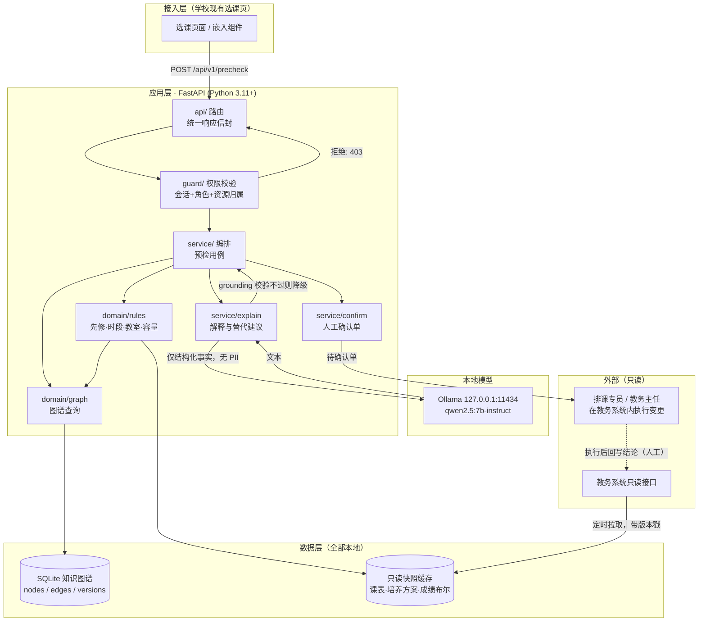

# 排课选课冲突预检与解释系统 · 技术方案

> 项目：知行职业学院 · 排课选课与教务协作
> 阶段：FDE 九阶段 · 04 方案设计（phase2）
> 版本：v1.0-draft
> 评审门槛：试点边界、方案取舍、数据权限与实施计划已评审
> 训练约束声明：本方案基于合成训练场景编写，不代表真实授权、业务执行或客户验收。所有数字均为**待验证估算**，标注 `[假设]` 的条目必须在试点中核验。

---

## 0. 一页结论

| 项 | 结论 |
|---|---|
| 最小试点 | 只在**选课提交前**做「冲突预检 + 人话解释 + 替代建议」，覆盖 1 个专业 4 个班约 180 人、1 个学期 |
| 技术路线 | 规则引擎判定 + 知识图谱取事实 + 本地模型（Ollama）负责理解与表达 |
| 硬边界 | 系统**只读**教务数据，不写任何教务库；三类变更走人工确认单 |
| 为什么不是纯模型 | 先修/教室/时段冲突是可判定的确定性问题，交给模型必然幻觉，且无法通过教务审计 |
| 为什么不是纯规则 | 纯规则只能给出"冲突"两个字，学生仍要打电话问辅导员，返工工单不下降 |
| 首年成本 | ¥89,600（一次性 ¥68,000 + 月运行 ¥1,800×12）`[假设]` |
| 首年年化收益 | ¥130,000（节省 400 人时 + 调课协调成本）`[假设]` |
| 首年净收益 / ROI / 回本 | ¥40,400 / 45% / 约 8.3 个月 `[假设]` |
| 停止条件 | 试点 6 周冲突类工单下降 < 15%，停止扩展并回退到方案 B（纯规则） |

---

## 1. 业务问题与上游承接

### 1.1 问题原话

> 我们在"排课选课与教务协作"上投入了很多人力。学生看到可选课程，但选后才发现先修课或教室冲突。管理层希望用 AI 改善，但还没有确定优先环节、验收标准和权限边界。

### 1.2 现状链路拆解（工作流）

选课这件事实际是 7 步，摩擦不在"选"，在"提交之后的第 5 步"：

| 步骤 | 动作 | 执行者 | 现状摩擦 | 后果 |
|---|---|---|---|---|
| S1 | 培养方案下发、课程属性维护 | 专业课程负责人（叶书） | 先修关系散落在培养方案文档与教务系统两处 | 图谱数据源不一致 |
| S2 | 开课计划与教室分配 | 排课专员（唐映秋） | 教室容量与时段靠人工表格核对 | 排完才发现容量不足 |
| S3 | 开放选课、学生浏览 | 学生 | 页面只校验"是否已选/容量"，不校验先修与时段 | 学生看到的是"可选" |
| S4 | 学生提交 | 学生 | 提交瞬间才触发校验，且只报错误码 | 不知道错在哪、怎么改 |
| S5 | 教务批量核对冲突 | 排课专员 + 辅导员（林亦舟） | 逐条人工比对先修表与教室表 | 高峰期 5 小时/周 |
| S6 | 退改选、通知、二次调整 | 辅导员 + 教务主任（顾明岚） | 学生反复来问，答案每次重新查 | 重复答疑 6 小时/周 |
| S7 | 质量抽查与合规留痕 | 教学质量专员（傅景） | 抽查靠抽样翻单 | 覆盖率低、无法追溯 |

**关键结论：S3 是唯一能"提前"的位置。** 在 S3 就把冲突说清楚，S5/S6 的人工量才会降；在 S4 之后做任何事都只是加速返工。

### 1.3 需求承接（与 03 需求定义对齐）

> 交付前请把下列编号替换为阶段 03 实际确认的需求编号；当前为占位编号，来源列已标注事实出处角色。

| 编号 | 需求 | 来源角色 | 验收口径 |
|---|---|---|---|
| RQ-01 | 学生在提交前能看到"是否满足先修 + 是否时段/教室冲突" | 排课专员、辅导员 | 冲突召回率 100%（对齐教务系统已记录冲突） |
| RQ-02 | 冲突要用人话说明原因，并给 2 个可执行替代 | 辅导员、学生 | 抽样 100 条，解释被采纳 ≥ 60% |
| RQ-03 | 教务侧不再逐条手工比对，改为看系统结论并复核例外 | 排课专员 | 手工核对时长下降 ≥ 50% |
| RQ-04 | 任何"放宽限制/改容量/换教室"必须人工确认，系统不得自动执行 | 教务主任 | 越权与自动执行用例 0 通过 |
| RQ-05 | 抽查可追溯到"依据哪条培养方案条款、哪个数据版本" | 教学质量专员 | 每条结论可回溯到条款号 + 数据版本号 |

---

## 2. 最小试点（solution-wedge）

### 2.1 试点边界

**做：**

- 覆盖 2025–2026 春季学期 · 计算机科学与技术专业 · 2024 级 4 个班（约 180 人）、约 40 门开课班
- 只做**预检与解释**：输入（学号哈希 + 拟选课程列表），输出（通过/冲突 + 冲突明细 + 替代建议）
- 只读教务系统课表、培养方案、成绩（仅"是否通过+学分"布尔）

**不做（明确排除，防止试点膨胀）：**

- 不做选课容量分配、不做抽签/排队算法
- 不做教师排课调整、不做教室自动重排
- 不做跨专业学分互认、不做成绩替代认定
- 不做前端选课页重构（只提供 JSON 接口，学校现有页面嵌一个组件）
- 不做任何写教务库的动作

### 2.2 三方案比较

| 维度 | A 人工优化（加人 + FAQ） | B 纯确定性规则引擎 | C 规则 + 知识图谱 + 本地模型（本方案） |
|---|---|---|---|
| 判定准确性 | 高但会疲劳出错 | 高（可审计） | 高（判定仍由规则做） |
| 解释能力 | 取决于人 | 低（只给错误码） | 高（人话 + 替代方案） |
| 对返工工单的影响 | 几乎无（只缓解排队） | 中（学生仍需自己理解错误码） | 高 |
| 落地周期 | 1 周 | 3 周 | 6 周 |
| 一次性成本 `[假设]` | ¥15,000（FAQ/培训） | ¥45,000 | ¥68,000 |
| 月运行成本 `[假设]` | ¥6,000（0.5 人力） | ¥600 | ¥1,800（含本地算力与运维） |
| 风险 | 人力不可持续、无沉淀 | 解释不足导致需求不达标 RQ-02 | 模型幻觉、图谱过期 |
| 可审计性 | 无留痕 | 强 | 强（模型输出需过 grounding 校验） |
| 结论 | 仅作为兜底 | 作为 C 的降级模式 | **选用** |

**取舍理由：** 选 C，但把 C 的职责压到"只解释、不决策"。判定逻辑全部落在规则引擎（可单测、可审计、可复现），模型只承担把结构化结论转成人话、把学生自然语言诉求转成结构化查询这两件事。这样即使模型完全不可用，系统仍能返回正确的规则结论（见 5.6 降级矩阵），试点价值不依赖模型质量。

### 2.3 试点验收标准（量化，可判定）

| 指标 | 目标 | 测量方法 |
|---|---|---|
| 冲突召回率 | 100% | 用教务系统上学期已记录的 456 条冲突做回放，漏报 0 条 |
| 误报率 | < 2% | 同上回放，误报 ≤ 9 条 |
| P95 响应延迟 | < 800 ms（含模型解释） | 压测 50 并发，日志计时 |
| 解释采纳率 | ≥ 60% | 抽样 100 条，辅导员 + 学生双盲打分 |
| 越权用例通过率 | 0 | 权限用例集 32 条全量回归 |
| 模型不可用可用性 | 100% 返回规则结论 | 停掉 Ollama 后跑全量用例 |
| 手工核对时长 | 下降 ≥ 50% | 排课专员 2 周工时记录对比基线 |

---

## 3. 总体架构

### 3.1 架构图



**架构分层（GitHub 版见上方 Mermaid 图；Word 版以此表为准）：**

| 层 | 组件 | 职责 | 依赖方向 |
|---|---|---|---|
| 接入层 | 学校现有选课页 / 嵌入组件 | 只负责发起预检、展示结论 | → 应用层（仅 HTTPS JSON） |
| 接口层 | `api/` 路由 + 统一信封 | 参数校验、鉴权入口、错误归一 | → guard |
| 权限层 | `guard/` 会话 + RBAC + 数据范围 | 判定"谁能看谁的数据"，拒绝即 403 | → service |
| 编排层 | `service/` precheck / explain / confirm | 串起判定、解释、确认单，处理降级 | → domain、adapters |
| 判定层 | `domain/rules` 先修·时段·教室·容量 | **唯一有权给出结论的地方**，纯函数无副作用 | → domain/graph |
| 图谱层 | `domain/graph` + SQLite | 只读遍历，取事实，不做判断 | → `data/kg.db` |
| 适配层 | `adapters/` edu / ollama / kg_store | 超时、重试、熔断、脱敏 | → 教务只读接口、本机 Ollama |
| 数据层 | SQLite 图谱 + 只读快照缓存 | 本地单文件，无外部服务 | — |

### 3.2 分层与目录

```text
app/
├── main.py                  # FastAPI 实例装配、中间件、异常兜底
├── config.py                # 读取 config.yaml，禁止硬编码
├── api/
│   ├── deps.py              # 鉴权依赖、请求上下文
│   ├── precheck.py          # 预检接口
│   ├── graph.py             # 图谱只读查询接口
│   └── confirm.py           # 人工确认单接口
├── guard/
│   ├── rbac.py              # 角色-资源-动作矩阵校验
│   └── scope.py             # 数据范围（本人/本班）校验
├── domain/
│   ├── rules/prereq.py      # 先修闭包判定
│   ├── rules/timetable.py   # 时段与教室冲突判定
│   ├── rules/capacity.py    # 容量判定
│   └── graph/query.py       # 图谱查询（只读）
├── service/
│   ├── precheck.py          # 预检用例编排
│   ├── explain.py           # 解释生成 + grounding 校验
│   └── confirm.py           # 确认单创建与流转
├── adapters/
│   ├── edu_client.py        # 教务只读接口客户端（超时/重试/熔断）
│   ├── ollama_client.py     # 本地模型客户端（超时/降级）
│   └── kg_store.py          # SQLite 图谱读写
├── prompts/                 # 提示词版本化，见 docs/提示词.md
└── common/
    ├── envelope.py          # {"ok","data","error"} 统一封装
    └── errors.py            # 错误码枚举
config.yaml                  # 唯一配置入口
data/kg.db                   # 知识图谱库文件
tests/                       # pytest 用例与权限回归集
```

### 3.3 技术栈（锁定，不替换）

| 层 | 选型 | 说明 |
|---|---|---|
| 语言 | Python 3.11+ | 要求的最低版本，用 `tomllib`/`match` 等 3.11 特性 |
| Web 框架 | FastAPI + Uvicorn | 唯一 Web 框架 |
| 数据校验 | Pydantic v2（FastAPI 自带） | 不额外引入 ORM |
| 知识图谱 | SQLite 三元组表 + 邻接索引 | 零外部服务、单文件、可随镜像分发；见第 4 章 |
| 本地模型 | Ollama（`/api/chat`） | 只走 127.0.0.1，不出网 |
| 配置 | `config.yaml` + 环境变量覆盖 | 密钥与模型地址只在配置里 |
| 测试 | pytest + httpx | 不引入额外测试中间件 |

**显式不引入：** 不使用向量数据库（图谱查询是结构化遍历，不需要 embedding 检索）、不使用消息队列（试点无异步任务）、不使用 Redis（SQLite 文件缓存足够）、不使用 LangChain 等编排框架（编排逻辑只有 4 个函数，自写更可控可测）。

### 3.4 一次预检的运行时序

1. 客户端 `POST /api/v1/precheck`，体：`{student_ref, term, offering_ids[]}`
2. `guard` 校验：会话有效 → 角色为 `student` 或以上 → `student_ref` 解析为本人才放行
3. `service.precheck` 取数据版本戳，从快照读该生已修课程集合（仅"课程号 + 是否通过 + 学分"）
4. `rules.prereq` 计算先修闭包，`rules.timetable` 比对时段/教室，`rules.capacity` 比对容量
5. 若有冲突 → `service.explain` 把**结构化事实**（无 PII）交给 Ollama 生成解释
6. `grounding` 校验：模型每个断言必须在事实集合中有支撑，否则丢弃该句并降级为模板话术
7. 需要放行/变更的 → `service.confirm` 生成确认单，状态 `pending`，等人工
8. 返回统一信封

### 3.5 接口契约

统一响应结构（**所有**对外接口，含异常路径）：

```json
{ "ok": true, "data": {}, "error": null }
{ "ok": false, "data": null, "error": { "code": "FORBIDDEN_SCOPE", "msg": "只能查询本人选课" } }
```

核心接口：

| 方法 | 路径 | 作用 | 角色 |
|---|---|---|---|
| POST | `/api/v1/precheck` | 提交前冲突预检 + 解释 + 替代 | student, counselor, scheduler |
| GET | `/api/v1/graph/prereq-closure` | 查先修闭包（调试与教务复核用） | scheduler, engineer, director |
| POST | `/api/v1/confirm` | 创建人工确认单（不执行变更） | scheduler 创建 / director 审批 |
| GET | `/api/v1/confirm/{id}` | 查确认单状态 | 按资源归属 |
| GET | `/health` | 存活 + 模型/图谱连通性 | 无鉴权（仅返回布尔） |

错误码表：

| code | HTTP | 含义 | 客户端行为 |
|---|---|---|---|
| `OK` | 200 | 成功 | — |
| `INVALID_INPUT` | 400 | 参数缺失或格式错 | 提示修正 |
| `UNAUTHENTICATED` | 401 | 无会话 | 跳登录 |
| `FORBIDDEN_SCOPE` | 403 | 越权访问他人数据 | 禁止重试 |
| `NEED_CONFIRM` | 409 | 该操作必须人工确认 | 展示确认单 |
| `KG_VERSION_STALE` | 409 | 图谱版本落后于教务快照 | 提示数据可能过期 |
| `MODEL_UNAVAILABLE` | 200 | 模型不可用，已降级为规则话术 | 正常展示（`data.degraded=true`） |
| `UPSTREAM_TIMEOUT` | 504 | 教务接口超时 | 重试一次后提示 |

### 3.6 降级矩阵

| 故障 | 系统行为 | 用户可见 |
|---|---|---|
| Ollama 不可用/超时 | 跳过解释生成，用规则模板话术 | 结论正确，解释较生硬，`data.degraded=true` |
| 模型输出未通过 grounding | 丢弃不实断言，保留通过部分；全不过则用模板 | 同上 |
| 图谱版本落后教务快照 | 正常返回，附版本告警 | 页脚提示"数据截至 xx 时" |
| 教务接口超时 | 用最近快照，标记 `stale` | 提示"数据可能不是最新，请以教务系统为准" |
| SQLite 文件损坏 | 拒绝预检，返回 503 明确文案 | 不用旧数据猜结论 |

---

## 4. 知识图谱设计

### 4.1 本体

**节点（7 类）**

| 节点 | 主键 | 关键属性 | 来源 |
|---|---|---|---|
| `Course` 课程 | course_code | 名称、学分、课程性质 | 培养方案 |
| `Offering` 开课班 | offering_id | 学期、容量、已选数、上课周次 | 教务课表 |
| `Teacher` 教师 | teacher_id | 姓名（仅内部展示，不进模型） | 教务课表 |
| `Room` 教室 | room_id | 容量、类型（机房/普通） | 教务课表 |
| `TimeSlot` 时段 | slot_id | 星期、节次、起止时间 | 教务课表 |
| `RuleClause` 培养方案条款 | clause_id | 条款原文、生效年级、版本 | 培养方案文档 |
| `Major` 专业 | major_code | 名称、年级 | 培养方案 |

> 学生**不建为图谱节点**，只以 `student_ref`（盐化哈希）作为查询入参，避免图谱成为 PII 聚合地。

**边（8 类）**

| 边 | 起点 → 终点 | 语义 | 判定用途 |
|---|---|---|---|
| `PREREQUISITE_OF` | Course → Course | A 是先修 | 先修闭包 |
| `CO_REQUISITE_OF` | Course → Course | 必须同学期 | 捆绑校验 |
| `OFFERED_AS` | Course → Offering | 本学期开了哪些班 | 选班 |
| `HELD_IN` | Offering → Room | 在哪上课 | 教室冲突 |
| `AT_SLOT` | Offering → TimeSlot | 什么时段 | 时段冲突 |
| `TAUGHT_BY` | Offering → Teacher | 谁上 | 教师冲突 |
| `BELONGS_TO` | Course → Major | 属于哪个专业方案 | 范围过滤 |
| `GOVERNED_BY` | Course → RuleClause | 依据哪条条款 | RQ-05 可追溯 |

### 4.2 存储（SQLite，零外部服务）

```sql
-- 节点表：所有类型共用，type 区分；props 存 JSON，避免为每类建表
CREATE TABLE nodes (
  id          TEXT PRIMARY KEY,          -- 节点主键，如 course:CS201
  type        TEXT NOT NULL,             -- Course/Offering/Room/TimeSlot/RuleClause/...
  props       TEXT NOT NULL DEFAULT '{}',-- JSON 属性，只放白名单字段
  version     TEXT NOT NULL              -- 数据版本戳，用于过期判定
);

-- 边表：三元组 + 反向索引，先修闭包靠递归 CTE 遍历
CREATE TABLE edges (
  src        TEXT NOT NULL,              -- 起点节点 id
  rel        TEXT NOT NULL,              -- PREREQUISITE_OF / HELD_IN / AT_SLOT / ...
  dst        TEXT NOT NULL,              -- 终点节点 id
  props      TEXT NOT NULL DEFAULT '{}', -- 边属性，如生效年级
  version    TEXT NOT NULL,              -- 数据版本戳
  PRIMARY KEY (src, rel, dst)
);

-- 邻接索引：出边与入边各一个，保证双向遍历都走索引
CREATE INDEX idx_edges_out ON edges(src, rel);
CREATE INDEX idx_edges_in  ON edges(dst, rel);

-- 快照元信息：图谱版本与教务快照时间，用于 stale 判定
CREATE TABLE snapshot_meta (
  key   TEXT PRIMARY KEY,                -- kg_version / edu_snapshot_at / built_at
  value TEXT NOT NULL
);
```

**为什么不选 Neo4j / NetworkX：** Neo4j 需额外服务与运维，违反"不引入中间件"；NetworkX 是纯内存图，重启即丢，180 人 × 40 课规模下 SQLite 递归 CTE 查询在毫秒级，够用。

### 4.3 关键查询

先修闭包（递归 CTE，带环路保护）：

```sql
-- 求某课程的全部先修（间接），depth 限制防止脏数据造成的环
WITH RECURSIVE pre(course_id, depth) AS (
  SELECT dst, 1 FROM edges WHERE src = :course_id AND rel = 'PREREQUISITE_OF'
  UNION
  SELECT e.dst, p.depth + 1
  FROM edges e JOIN pre p ON e.src = p.course_id
  WHERE e.rel = 'PREREQUISITE_OF' AND p.depth < 6
)
SELECT DISTINCT course_id FROM pre;
```

时段冲突（同一学期内拟选课程两两比对）：

```sql
-- 找出与给定开课班共享同一 TimeSlot 的其他开课班
SELECT b.id AS conflict_offering
FROM edges a
JOIN edges b ON b.dst = a.dst AND b.rel = 'AT_SLOT'
WHERE a.src = :offering_id AND a.rel = 'AT_SLOT' AND b.src <> :offering_id;
```

### 4.4 数据版本与过期

- 每次从教务系统拉取生成 `edu_snapshot_at`；图谱重建后写 `kg_version`
- 预检响应必带 `data_version`，前端展示"数据截至 xx"
- 若 `now - edu_snapshot_at > config.kg.stale_hours`（默认 24h）→ 返回 `KG_VERSION_STALE` 告警但仍给结论（附"以教务系统为准"）

---

## 5. 权限与人工确认

### 5.1 角色—资源权限矩阵

R = 读，W = 写（本系统内的确认单），— = 无权限。**注意：本系统对教务数据一律只读，W 只作用于本系统自己的确认单表。**

| 资源 / 角色 | 学生 | 辅导员 | 排课专员 | 系统工程师 | 质量专员 | 课程负责人 | 教务主任 |
|---|---|---|---|---|---|---|---|
| 本人预检结果 | R | — | — | — | — | — | — |
| 本班学生预检结果 | — | R | R | — | R（脱敏聚合） | — | R |
| 全校预检结果 | — | — | R | R | R（脱敏聚合） | — | R |
| 培养方案 / 条款 | R | R | R | R | R | R | R |
| 开课班与教室 | R | R | R | R | R | R | R |
| 图谱重建 | — | — | — | W | — | — | — |
| 确认单（放宽限制/改容量/换教室） | — | — | W（发起） | — | — | — | W（审批） |
| 系统配置 / 密钥 | — | — | — | W | — | — | R（只读） |
| 审计日志 | — | — | R（本人操作） | R | R | — | R |

### 5.2 三个必须人工确认的写操作

这三类操作会改变学生的实际选课结果，模型与规则**都不得直接执行**：

| 操作 | 为什么必须卡 | 确认链 |
|---|---|---|
| ① 放开先修冲突强制选课 | 先修是培养方案的硬约束，放开等于替专业负责人做了学术判断，出错影响毕业审核 | 学生申请 → 辅导员核实 → 课程负责人（叶书）同意 → 教务主任（顾明岚）审批 |
| ② 调整开课班容量 | 涉及教室容量与教师工作量，超出教室上限会有安全与教学事故风险 | 排课专员发起 → 教务主任审批 |
| ③ 替换教室 / 时段 | 会连锁影响其他班级与教师，属于全局排课问题 | 排课专员发起 → 教务主任审批 |

**实现约束：** `POST /api/v1/confirm` 只创建状态为 `pending` 的记录并返回确认单号，**不触发任何教务写操作**。真正的变更由人工在教务系统内执行，执行后由人工回填结论（`approved_executed` / `rejected`）。系统留下的是一条可审计的决策链，不是一个自动执行器。

### 5.3 校验链路（前端声明一律不可信）

1. 会话 → 角色：从服务端会话取，绝不接受请求体里的 `role`
2. 资源归属：`student_ref` 必须能解析为会话本人（学生）或在本班范围内（辅导员）
3. 动作许可：`guard.rbac` 矩阵查表，未命中即 403
4. 二次校验：写确认单前重查一次权限（防 TOCTOU）
5. 留痕：每次拒绝都写审计日志（谁、什么资源、什么动作、什么时间）

---

## 6. 数据红线

| 类别 | 规则 |
|---|---|
| 采集白名单 | 课程号、开课班号、学期、学分、是否通过（布尔）、教室、时段、教师工号 |
| 绝不采集 | 身份证号、手机号、家庭住址、家庭情况、奖惩记录、心理健康、体检、照片 |
| 学号处理 | 入库与日志一律用 `sha256(salt + 学号)` 的 `student_ref`；salt 只在 `config.yaml`，不入库不入日志 |
| 成绩处理 | 只转成"是否通过 + 学分"两个字段；原始分数不进图谱、不进模型上下文 |
| 模型上下文 | 只送**课程号、课程名、时段、教室、条款编号与条款原文**；不送姓名、学号、班级、成绩 |
| 模型出网 | `base_url` 强制 `127.0.0.1`，代码启动时校验，非本地地址直接拒绝启动 |
| 日志 | 结构化日志不含 PII；请求体落盘前过 `redact()`；保留 90 天 |
| 留存 | 预检结果保留 1 学期用于回放评估，到期删除；确认单与审计日志保留 3 年 |
| 导出 | 任何导出接口强制脱敏，且记录导出人与用途 |

---

## 7. 报价与投入产出（solution-plan）

### 7.1 报价单（一次性）

| 项 | 内容 | 金额 `[假设]` |
|---|---|---|
| 需求与图谱建模 | 培养方案解析、本体设计、先修关系清洗 | ¥18,000 |
| 规则引擎与预检服务 | 先修闭包、时段/教室/容量判定、单测 | ¥16,000 |
| 解释层与 guard | 本地模型接入、grounding 校验、降级链路 | ¥14,000 |
| 权限与确认单 | RBAC、数据范围、确认单流转与审计 | ¥12,000 |
| 部署与联调 | 校内服务器部署、Ollama 模型落地、灰度 | ¥8,000 |
| **合计** | | **¥68,000** |

### 7.2 月度运行成本

| 项 | 说明 | 金额/月 `[假设]` |
|---|---|---|
| 服务器 | 校内现有虚拟机（8C/32G/单卡 24G 显存）折旧分摊 | ¥900 |
| 运维 | 数据同步巡检、模型版本升级，约 4 小时/月 | ¥600 |
| 电力与耗材 | 本地推理电费 | ¥300 |
| **合计** | | **¥1,800** |

### 7.3 收益测算

基线（来自阶段 01/02 访谈的量级估算，须按样本核验）：

| 基线项 | 数值 | 来源 |
|---|---|---|
| 每学期退改选工单 | 1,200 件 | 排课专员口述量级 `[假设]` |
| 其中先修/教室冲突导致 | 38%（456 件） | 抽样 100 件标定 `[假设]` |
| 单件平均处理时长 | 15 分钟 | 辅导员 + 教务分摊 `[假设]` |
| 辅导员重复答疑 | 6 小时/周 | 辅导员口述 `[假设]` |
| 排课专员冲突核对 | 5 小时/周 | 排课专员口述 `[假设]` |
| 教室临时调整协调 | 约 120 次/年 × 45 分钟 | 排课专员口述 `[假设]` |
| 培养方案合规抽查 | 4 小时/周 | 质量专员口述 `[假设]` |

年节省人时（基准情景）：

| 项 | 计算 | 节省 |
|---|---|---|
| 冲突类工单 | 456 × 45% 下降 = 205 件/学期 × 2 学期 × 15 min | 102 人时 |
| 辅导员重复答疑 | 6h × 36 周 = 216h，降 60% | 130 人时 |
| 排课专员核对 | 5h × 36 周 = 180h，降 50% | 90 人时 |
| 教室临时调整 | 90h，降 40% | 36 人时 |
| 方案合规抽查 | 144h，降 30% | 43 人时 |
| **合计** | | **约 400 人时/年** |

综合人力成本按 ¥260/人时（含社保与管理分摊）`[假设]` → **¥104,000/年**；加上减少的调课通知与场地协调外部成本 ¥26,000/年 → **年化收益 ¥130,000**。

### 7.4 三档情景与回本

| 情景 | 年节省人时 | 年化收益 | 首年成本 | 首年净收益 | ROI | 回本期 |
|---|---|---|---|---|---|---|
| 保守 | 260 | ¥67,600 | ¥89,600 | −¥22,000 | −25% | > 12 个月 |
| **基准** | **400** | **¥130,000** | **¥89,600** | **+¥40,400** | **45%** | **约 8.3 个月** |
| 乐观 | 550 | ¥182,000 | ¥89,600 | +¥92,400 | 103% | 约 5.9 个月 |

> 回本期 = 首年成本 ÷ (年化收益 ÷ 12)。基准：89,600 ÷ (130,000 ÷ 12) = 8.27 个月。
> 保守情景首年不回本，这是**必须提前告知客户**的结论：本项目的收益高度依赖"冲突类工单占比"与"解释采纳率"两个假设。

### 7.5 收益验证计划（哪些收益必须先验）

| 假设 | 验证方式 | 判定门槛 | 时机 |
|---|---|---|---|
| 冲突类工单占比 38% | 抽取上学期 200 件工单人工归类 | 实际占比 ≥ 30% 才继续 | 试点 W1 |
| 单件处理 15 分钟 | 排课专员计时 20 件 | 实测 ≥ 12 分钟 | 试点 W1 |
| 工单下降 45% | 试点班 vs 对照班同期对比 | 下降 ≥ 25% 达标 | 试点 W5–W6 |
| 解释采纳率 60% | 抽样 100 条双盲打分 | ≥ 50% 可接受 | 试点 W4 |
| 核对时长降 50% | 排课专员 2 周工时记录 | ≥ 35% 可接受 | 试点 W6 |

### 7.6 停止条件

出现任一条件即停止扩展，回退方案 B（纯规则）或终止：

1. 试点 6 周内冲突类工单下降 < 15%
2. 冲突召回率 < 98%（漏报会直接造成选课事故）
3. 出现任何一次越权访问或自动执行变更
4. 模型输出无法通过 grounding 校验的比例 > 20%
5. 教务系统无法提供稳定的只读接口（数据同步成本超 ¥3,000/月）

---

## 8. 实施计划（6 周）

| 周 | 目标 | 交付 | 依赖 |
|---|---|---|---|
| W1 | 数据接入与图谱构建 | 培养方案解析脚本、`kg.db` 首版、先修关系核对报告 | 教务只读接口开通 |
| W2 | 规则引擎 | 先修闭包/时段/教室/容量判定 + 单测（覆盖率 ≥ 85%） | W1 图谱 |
| W3 | 解释层与 guard | Ollama 接入、prompt v1、grounding 校验、降级链路 | 本地 GPU 可用 |
| W4 | 权限与确认单 | RBAC 矩阵、32 条权限用例全绿、确认单流转 | W2 规则 |
| W5 | 灰度 | 1 个班（45 人）真实使用，收集 100 条解释样本 | 学校选课环境 |
| W6 | 评估与决策 | 回放评估报告、ROI 实测更新、扩展/停止建议 | W5 数据 |

---

## 9. 风险登记册

| # | 风险 | 影响 | 概率 | 缓解 | 兜底 |
|---|---|---|---|---|---|
| R1 | 模型幻觉出"看起来对"的错误先修结论 | 学生选课事故 | 中 | 判定永不交给模型；解释过 grounding 校验 | 降级为模板话术 |
| R2 | 图谱与教务系统不同步 | 结论过期 | 高 | 版本戳 + 24h 过期告警 + 每日重建 | 显示"以教务系统为准" |
| R3 | 培养方案先修关系本身有歧义 | 误报 | 中 | 引入 `RuleClause` 溯源，冲突时人工裁定 | 条款负责人确认 |
| R4 | 教务只读接口不稳定 | 预检不可用 | 中 | 快照缓存 + 熔断 + 超时 3s | 返回 stale 提示 |
| R5 | 权限绕过（改请求体伪造角色） | 数据泄露 | 低 | 角色只从服务端会话取 + 二次校验 | 审计告警 |
| R6 | 本地算力不足导致延迟 > 800ms | 体验差 | 中 | 7B 模型 + 短输出（≤120 字）+ 流式可选 | 只做规则结论 |
| R7 | 学生把解释当"官方许可" | 争议 | 中 | 文案明确"以教务系统结果为准" | 辅导员复核入口 |
| R8 | 试点范围蔓延到排课调整 | 项目失控 | 高 | 2.1 的"不做"清单写进合同 | 变更单审批 |

---

## 10. 代码规范落点

### 10.1 `config.yaml`（唯一配置入口）

```yaml
# 服务配置：监听地址与端口
server:
  host: 127.0.0.1          # 只监听本机，避免暴露到校园网
  port: 8000               # 与学校网关反代端口对应
  request_timeout_s: 5     # 单请求硬超时，防止慢请求堆积

# 本地模型配置：地址与模型名绝不写死在代码里
llm:
  provider: ollama         # 固定 local 提供商
  base_url: http://127.0.0.1:11434   # 必须是本机，启动时强校验
  model: qwen2.5:7b-instruct         # 本地已拉取的模型名
  temperature: 0.1         # 低温度，减少解释的发散
  max_tokens: 220          # 解释文本上限，控制延迟
  timeout_s: 4             # 模型超时后走降级

# 知识图谱配置
kg:
  db_path: ./data/kg.db    # SQLite 文件位置
  stale_hours: 24          # 超过该小时数视为快照过期

# 教务只读接口
edu:
  base_url: http://edu-gw.internal/api   # 校内只读网关
  timeout_s: 3             # 上游超时
  retry: 1                 # 只重试一次，避免打爆上游

# 数据红线相关
privacy:
  student_salt: ${STUDENT_SALT}   # 从环境变量注入，不入库
  redact_keys: [name, id_card, phone, address]  # 日志脱敏字段
```

### 10.2 统一响应封装（每行带注释）

```python
# 定义统一信封的类型别名，约束 data 为任意可序列化对象、error 为可选字典
Envelope = dict[str, object]

def ok(data: object = None) -> Envelope:
    """构造成功响应。

    入参:
        data: 业务数据，必须可被 JSON 序列化；不需要返回数据时传 None。
    出参:
        形如 {"ok": True, "data": ..., "error": None} 的字典。
    失败行为:
        本函数不做异常捕获；若 data 不可序列化，由上层 FastAPI 序列化阶段
        抛 TypeError，统一异常处理器会转为 INTERNAL_ERROR 信封。
    """
    # 成功时 error 恒为 None，保证前端只需判断 ok 一个字段
    return {"ok": True, "data": data, "error": None}

def fail(code: str, msg: str) -> Envelope:
    """构造失败响应。

    入参:
        code: 机器可读的错误码，取自 errors.py 枚举，禁止临时拼字符串。
        msg:  面向用户的中文提示，不得包含学号、姓名等个人信息。
    出参:
        形如 {"ok": False, "data": None, "error": {"code":..., "msg":...}} 的字典。
    失败行为:
        不抛异常；即使 code 不在枚举内也照常返回，由审计日志记录非法码。
    """
    # 失败时 data 恒为 None，前端拿到 ok=false 即可直接读 error.msg 展示
    return {"ok": False, "data": None, "error": {"code": code, "msg": msg}}
```

### 10.3 权限校验（关键逻辑为什么这么卡）

```python
def assert_scope(ctx: RequestContext, student_ref: str) -> None:
    """校验请求者是否有权访问该 student_ref 的数据。

    入参:
        ctx:         请求上下文，含服务端会话解析出的角色与所属班级。
        student_ref: 目标学生的盐化哈希，来自请求参数（不可信）。
    出参:
        无返回值；校验通过即静默返回。
    失败行为:
        越权时抛 ForbiddenScope 异常，被全局处理器转为 403 + FORBIDDEN_SCOPE；
        不返回空数据、不返回默认值，避免"看起来成功"的静默越权。
    """
    # 角色只从服务端会话取：请求体里的 role 字段一律忽略，
    # 否则学生改一行 JSON 就能冒充教务主任，这是最常见的一类越权。
    role = ctx.role
    if role == Role.STUDENT:
        # 学生只能看自己：必须哈希后严格等值比较，不能用包含/前缀匹配，
        # 因为前缀匹配会让 A 学生的 ref 命中 B 学生的 ref。
        if not hmac.compare_digest(student_ref, ctx.own_student_ref):
            raise ForbiddenScope("只能查询本人选课")
    elif role == Role.COUNSELOR:
        # 辅导员只能看本班：班级边界来自服务端会话，不接受请求传入，
        # 否则辅导员可以遍历全校学生数据做批量导出。
        if not ctx.class_contains(student_ref):
            raise ForbiddenScope("只能查询本班学生")
    elif role in (Role.SCHEDULER, Role.ENGINEER, Role.DIRECTOR, Role.QUALITY):
        # 教务岗按矩阵放行；质量专员另由 service 层做聚合脱敏，不在此处放行明细
        return
    else:
        # 未知角色一律拒绝，采用白名单而非黑名单，新增角色必须显式登记
        raise ForbiddenScope("角色未授权")
```

---

## 11. 待验证假设与开放问题

**假设（必须在试点中核验）**

1. `[假设]` 冲突类退改选工单占全部工单 38%，单件处理 15 分钟
2. `[假设]` 综合人力成本 ¥260/人时
3. `[假设]` 学校可提供稳定的教务只读接口（含课表、培养方案、成绩布尔）
4. `[假设]` 校内服务器具备单卡 24G 显存，可跑 7B 模型且 P95 < 800ms
5. `[假设]` 学生愿意在提交前多看一眼解释（不被当成多余弹窗）

**开放问题**

1. 培养方案中"先修"是否允许"同修"（co-requisite）？当前按不允许处理，需叶书确认
2. 转专业/重修学生的先修闭包如何计算？试点暂按"已通过即满足"，是否认可替换课程待定
3. 教室容量是否含"站位"？影响容量判定阈值，需排课专员确认
4. 质量专员的抽查是否需要保留学生维度的原始记录（与数据红线冲突），需顾明岚裁定
5. 模型升级（7B→14B）是否需要重新做 grounding 回归？建议每次升级跑全量评测集

---

## 12. 附：术语

| 术语 | 含义 |
|---|---|
| 先修闭包 | 某课程直接与间接要求的全部前序课程集合 |
| 开课班（Offering） | 某学期某课程的一个具体教学班，含教师、教室、时段 |
| grounding 校验 | 检查模型每句断言是否能在给定事实集合中找到支撑，找不到即丢弃 |
| 降级 | 模型不可用或输出不可信时，退回规则模板话术，保证结论正确 |
| 确认单 | 本系统内的待办记录，代表"需要人工在教务系统执行变更"，本身不执行 |
