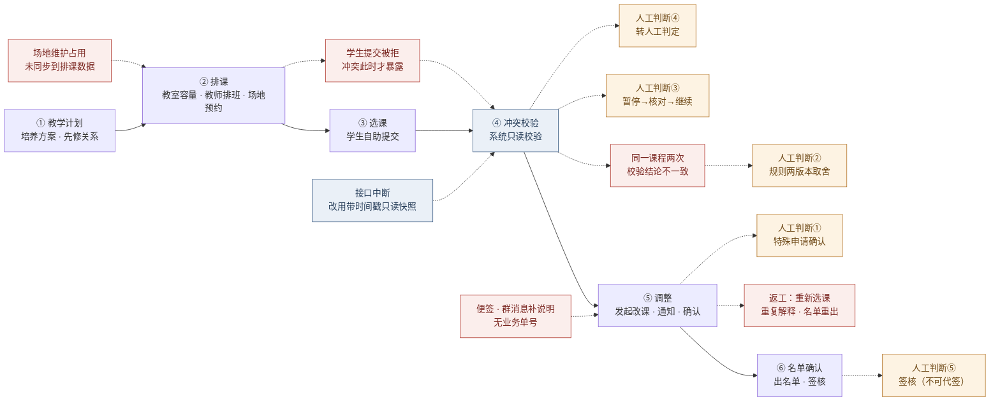
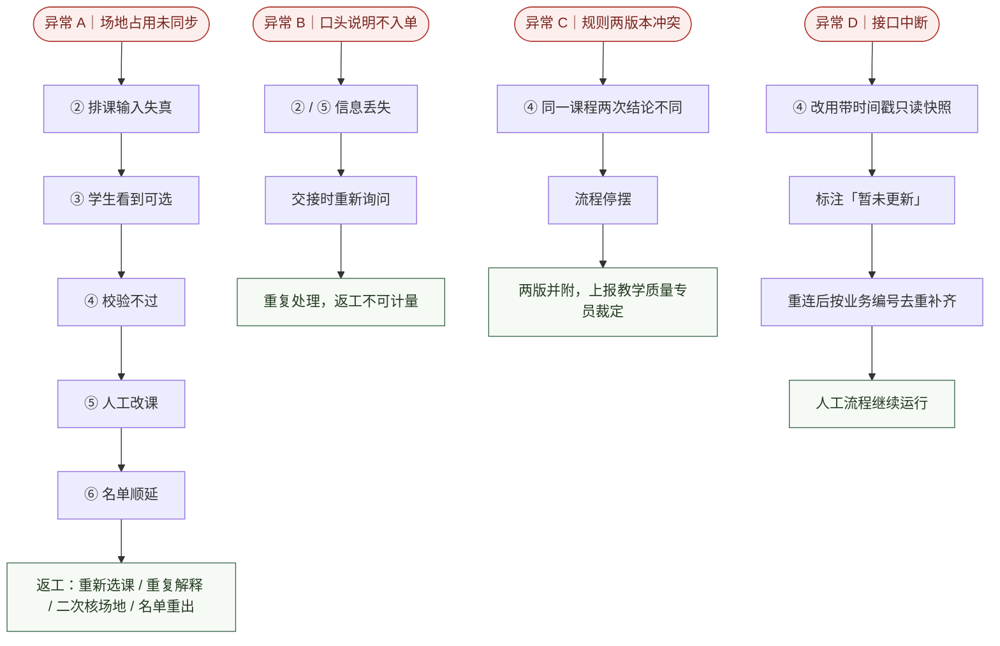

# 现状流程图 · 排课选课与教务协作

> 项目：知行职业学院 · 开学第一周的选课冲突（原创合成案例）
> 版本：v0.1（按角色口述还原，未经现场观察校验）
> 配套：`现状流程图.html`（可打印泳道图）、`现场调研分析.md`

**图例**：实线＝主流程　｜　虚线＝异常路径　｜　蓝色＝系统只读动作　｜　橙色＝只能由人完成的判断　｜　红色＝异常触发点　｜　灰色＝留痕缺失环节

---

## 1. 主流程图（Mermaid）

---

## 2. 泳道图（表格版，任何 Markdown 环境都能看）

| 角色 | ① 教学计划 | ② 排课 | ③ 选课 | ④ 冲突校验 | ⑤ 调整 | ⑥ 名单确认 |
|---|---|---|---|---|---|---|
| **学生**（间接受益者·未访谈） | | | **自助选课** 看到列表 → 提交选中 *卡点：列表不做资格实时校验* | | **重新选课** *返工点 1* | |
| **林亦舟**（班级辅导员·已访谈） | | | 现场辅导、代查先修课 *高峰只能用现有终端* | **发现冲突** 提交被拒后才暴露 *异常路径 A 入口* | **群消息通知** *返工点 2：重复解释* | |
| **场地管理方**（未列入访谈名单） | | **维护占用** 实训室设备维护 *未同步到排课数据* | | | | |
| **唐映秋**（排课专员·已访谈） | | **排课** 输入：容量／教师排班／场地预约 *卡点：场地占用不在输入内* | | **校验结果处理** 回查场地预约与排班 *返工点 3：二次核场地* | **发起改课** 整理／校核／发起复核 *退回须留原因* | **出名单** 以接手人确认才算完成 *返工点 4：名单重出* |
| **顾明岚／叶书**（教务主任／专业课程负责人） | **教学计划** 培养方案、先修关系定稿 *无版本台账* | | | | **人工判断 ①** 特殊申请与资格例外 *须教务确认* | **确认名单** 参与服务结果验收 |
| **傅景**（教学质量专员·已访谈） | | | | **人工判断 ②** 规则两版本取舍 *异常路径 C* | **人工判断 ③** 错误建议暂停→核对→继续 | **签核与审计** 编号／版本／改动／签核人 |
| **教务系统**（只读·秦芮负责） | | **三套系统并行** 教务／场地预约／学籍库 *账号权限独立，无统一视图* | | **只读校验** 可读课程与冲突 *不能选课、不能改成绩* | **异常路径 D** 断连用只读快照 *标「暂未更新」，按编号去重* | **更新节律** 15 分钟／超期标待刷新 |

---

## 3. 六节点要素表

| 节点 | 责任岗 | 输入 | 输出 | 留痕 | 卡点 |
|---|---|---|---|---|---|
| ① 教学计划 | 叶书＋教务 | 培养方案、先修关系 | 学期开课计划 | 培养方案版本（无版本台账） | 先修关系变更不同步到选课端 |
| ② 排课 | 唐映秋 | 教室容量、教师排班、场地预约状态 | 课表草案 | 课表文件（无版本号） | 场地占用变更不在输入内 |
| ③ 选课 | 学生自助＋林亦舟辅导 | 可选课程列表 | 选课记录 | 系统日志（有时间戳，可导出） | 列表生成时不做资格实时校验 |
| ④ 冲突校验 | 教务系统（只读） | 课程与冲突数据 | 冲突清单 | 校验结果（不落单据） | 位于选课之后；只读，不能改课 |
| ⑤ 调整 | 唐映秋发起→辅导员通知→学生确认 | 冲突清单＋特殊申请 | 调整方案 | 群消息与便签（不入单） | 退回原因非必填，口头说明不随单 |
| ⑥ 名单确认 | 唐映秋出名单→叶书/教务确认 | 调整后名单 | 最终名单 | 名单文件 | 以接手人确认计完成，发消息不算 |

---

## 4. 异常路径（四条）

| 路径 | 触发 | 处置 | 责任人 | 后果 |
|---|---|---|---|---|
| **A** 场地占用未同步 | 实训室维护临时占用，课表仍标可用 | 排课专员回查场地预约后改课，全程无单号 | 场地管理方＋唐映秋 | 返工集中在开学周 |
| **B** 口头说明不入单 | 一线用便签、群消息补关键说明 | 靠人来电或群里再问一遍，交接五项全缺 | 林亦舟→唐映秋 | 返工不可计量（M3 无法算） |
| **C** 规则两版本冲突 | 规则按生效日期切换 | 两版并附上报质量专员裁定，不自行合并 | 唐映秋→傅景 | 单笔时间不可控、无留痕 |
| **D** 接口中断 | 系统故障或接口中断 | 用只读快照并标注，重连按编号去重 | 秦芮 | 识别率须扣除停更样本 |

---

## 5. 只能由人完成的五处判断

| # | 判断点 | 责任人 | 为什么不能自动化 |
|---|---|---|---|
| ① | 课程资格与公平分配的特殊申请 | 教务 | 涉及规则以外的人为裁量，须留依据 |
| ② | 两版本规则取舍 | 教学质量专员 | 版本冲突时不存在唯一正解，须裁定并留痕 |
| ③ | 错误建议的暂停—核对—继续 | 辅导员提出、排课专员确认 | 错误结果不得覆盖原记录 |
| ④ | 是否转人工的触发判定 | 各岗按情形 | 四类情形需人判断上下文 |
| ⑤ | 名单最终确认与签核 | 教务／专业负责人 | 专业签核不可代签，发消息不算完成 |

**含义**：这五处决定了「不自动选课、不改成绩」不是保守，而是流程结构决定的硬边界。

---

## 6. 瓶颈与改造优先级

| 编号 | 瓶颈 | 主责 | 协同 | 前置条件 | 优先级 |
|---|---|---|---|---|---|
| **B3** | 留痕缺失导致返工不可计量 | 唐映秋（单据改造） | 傅景（审计要求） | 无，只改必填项 | 先做 |
| **B1** | 排课输入缺场地状态 | 场地管理方（数据源） | 秦芮（集成）、唐映秋（核对） | 拿到场地变更记录 | 次之 |
| **B2** | 校验时点错位（在选课之后） | 顾明岚（流程变更批准） | 秦芮（只读校验改造） | 先定 M1 分母口径 | 最后 |

---

## 7. 图未覆盖的部分（仍待核实）

1. 六节点耗时全部待采集（需选课日志＋工时表），图中刻意不填时长。
2. 场地占用变更的权威系统与同步时点未确认。
3. 特殊申请的审批路径与时限未确认。
4. 学生端列表是否含资格预校验未确认。
5. 本图按角色口述还原，需一次开学周现场观察校验，否则仍属「口述拼图」。
